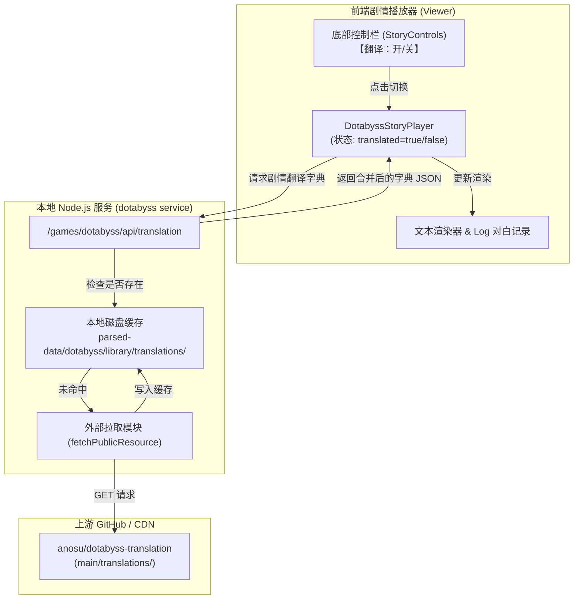

# DOTABYSS 剧情翻译资源集成设计 (Design Spec)

- **日期**：2026-10-18
- **主题**：集成 `anosu/dotabyss-translation` 汉化资源至 DOTABYSS 剧情播放器
- **模式**：前端运行时动态切换 + 后端按需拉取磁盘持久化缓存

---

## 1. 背景与目标

### 1.1 背景
[DMMgame Character Vault](file:///c:/Users/Harrishao/Desktop/repository/DMMgame-Character-Vault/README.md) 提供了 DOTABYSS 游戏的本地资源提取与完整原版视觉小说（Novel/Story）剧情播放引擎。目前提取的剧情对白与角色名字均为日文原版。
社区开源项目 [anosu/dotabyss-translation](https://github.com/anosu/dotabyss-translation) 提供了超过 1300+ 章节（含 650+ CG/R18 剧本、主线及活动）的逐句简体中文翻译、480+ 角色人名对照表及静态配置表。

### 1.2 目标
1. 在剧情播放器中提供中文/日文对白一键切换功能，无需双语。
2. 翻译开关放置于底部控制栏：`【上一页】/【下一页】/【从头播放】/【翻译：开/关】`。
3. 文本翻译支持：
   - 角色对白文本：基于章节分段映射表替换为中文。
   - 说话人姓名：基于人名表替换为中文；玩家占位符（`<user>`、`<player>`）在翻译开启时显示为 **`司令官`**。
   - 对白历史记录（Log/Backlog）：同步支持中/日文切换。
4. 资源获取方式：在线按需拉取，拉取后自动缓存到本地磁盘 `parsed-data/dotabyss/library/translations/`，实现“首次在线下载、之后永久离线可用”。
5. 容错与优雅降级：网络异常、缺失翻译章节或单句漏翻时自动回退为日文原文，不影响播放器稳定性。

---

## 2. 总体架构与数据流



---

## 3. 详细设计

### 3.1 后端服务：翻译代理与本地缓存

#### 3.1.1 存储路径
- 缓存根目录：`parsed-data/dotabyss/library/translations/`
  - 人名表：`translations/names/zh_Hans.json`
  - 剧本表：`translations/novels/<segment_id>/zh_Hans.json`

#### 3.1.2 服务端路由接口
在 [`games/dotabyss/src/service.ts`](file:///c:/Users/Harrishao/Desktop/repository/DMMgame-Character-Vault/games/dotabyss/src/service.ts) 增加处理逻辑：
- **请求路由**：`GET /games/dotabyss/api/translation?segments=<seg1,seg2...>`
- **处理步骤**：
  1. 解析查询参数 `segments`（逗号分隔的分段 ID 列表，例如 `hmr_11000100011,hmr_11000100012,hmr_11000100013`）。
  2. 获取 `names/zh_Hans.json`：
     - 检查本地磁盘是否存在，若无则从 `https://raw.githubusercontent.com/anosu/dotabyss-translation/main/translations/names/zh_Hans.json` 下载并保存。
  3. 对每一个 `segment`：
     - 检查本地磁盘 `translations/novels/<segment>/zh_Hans.json`，若无则向 `https://raw.githubusercontent.com/anosu/dotabyss-translation/main/translations/novels/<segment>/zh_Hans.json` 下载并保存。
     - 若上游返回 404（尚未汉化），记录为空映射，不抛出异常。
  4. 将所有人名与各分段的对白映射合并为一个 JSON 响应：
     ```json
     {
       "names": {
         "フェルトゥーナ": "菲尔图娜",
         "ナイア": "奈亚"
       },
       "dialogues": {
         "フェルちゃんフェルちゃん、いいもの買ってきたよ～！": "菲尔酱菲尔酱，我买了好东西回来哦～！",
         "これなに？　うま？　ガブガブ。": "这是什么？好吃吗？啊呜啊呜。"
       }
     }
     ```

### 3.2 前端播放器 UI 与控制交互

#### 3.2.1 底部工具栏布局
在 [`app/viewer/story-controls.ts`](file:///c:/Users/Harrishao/Desktop/repository/DMMgame-Character-Vault/app/viewer/story-controls.ts) 中：
- 在通用工具栏右侧动作组或通过回调扩展，插入翻译切换按钮。
- 在 `DotabyssStoryPlayer` 实例化 `StoryControls` 时，传入 `translate` 回调与配置。
- 按钮排列顺序严格为：
  `【上一页】` / `【下一页】` / `【从头播放】` / `【翻译：开】` (或 `【翻译：关】`)
- 按钮文本样式：
  - 翻译开启状态：按钮文字显示为 `翻译：开`（带有激活样式高亮）。
  - 翻译关闭状态：按钮文字显示为 `翻译：关`。

#### 3.2.2 偏好持久化与初始化
- 存储键名：`localStorage.getItem('dotabyss-story-translate')`
- 默认值：`true`（开）
- 打开任意剧情时，播放器根据该设置自动请求当前剧情翻译数据并应用。

### 3.3 文本匹配与渲染细节

#### 3.3.1 说话人姓名渲染
```typescript
function resolveSpeaker(speaker: string, isTranslated: boolean, namesMap: Record<string, string>): string {
  if (!speaker) return '';
  if (speaker === '<user>' || speaker === '<player>') {
    return isTranslated ? '司令官' : 'プレイヤー';
  }
  if (isTranslated && namesMap[speaker]) {
    return namesMap[speaker];
  }
  return speaker;
}
```

#### 3.3.2 对白文本渲染
```typescript
function resolveDialogue(text: string, isTranslated: boolean, dialoguesMap: Record<string, string>): string {
  if (!isTranslated || !dialoguesMap) return text;
  // 1. 精确匹配
  if (dialoguesMap[text]) return dialoguesMap[text];
  // 2. 换行标准化容错匹配 (<br/>, <br >, \r\n 等统一为 <br>)
  const normalized = text.replace(/<br\s*\/?>/gi, '<br>').trim();
  for (const [key, val] of Object.entries(dialoguesMap)) {
    if (key.replace(/<br\s*\/?>/gi, '<br>').trim() === normalized) {
      return val;
    }
  }
  // 3. 降级回退原文
  return text;
}
```

#### 3.3.3 对白记录 (Backlog / Log)
在 [`games/dotabyss/viewer/story-ui.ts`](file:///c:/Users/Harrishao/Desktop/repository/DMMgame-Character-Vault/games/dotabyss/viewer/story-ui.ts) 的 `openLog()` 中：
- 原逻辑遍历 `player.story.program.commands`。
- 获取说话人和内容时，调用 `resolveSpeaker` 和 `resolveDialogue`，从而让 Log 弹窗与当前翻译开关保持一致。

---

## 4. 容错与异常处理

1. **上游网络受限/失败**：
   - 若向 GitHub 请求失败（超时或连接重置），后端捕获错误并返回空字典 `{ names: {}, dialogues: {} }`。
   - 前端静默降级为日文原文，并在控制台输出友好警告，绝对不阻断播放器加载。
2. **单句缺失**：
   - 字典中找不到的句子直接显示原日文，不出现空白文本。
3. **分段缺失**：
   - 若剧情中的前戏已翻译但 CG 段未翻译，已翻译分段正常显示中文，未翻译分段自动使用日文。

---

## 5. 验证与测试方案

1. **构建与类型验证**：
   - 执行 `npm run typecheck` 保证 TypeScript 类型无报错。
   - 执行 `npm run build:viewer` 确保前端构建产物 `app/viewer/app.js` 及 `games/dotabyss/dist/module.js` 正常生成。
2. **功能测试**：
   - 打开已有缓存测试剧本（如 `dotabyss-hmr_11000100012`）。
   - 验证后端成功请求并在本地创建 `parsed-data/dotabyss/library/translations/` 文件。
   - 验证底部按钮显示为 `【翻译：开】`，对白显示中文，玩家显示为 `司令官`。
   - 点击切换为 `【翻译：关】`，对白即时变回日文，玩家显示为 `プレイヤー`。
   - 打开“对白记录”，验证 Log 弹窗内语言与按钮开关一致。
   - 刷新页面，验证 localStorage 记忆的翻译开关状态。
